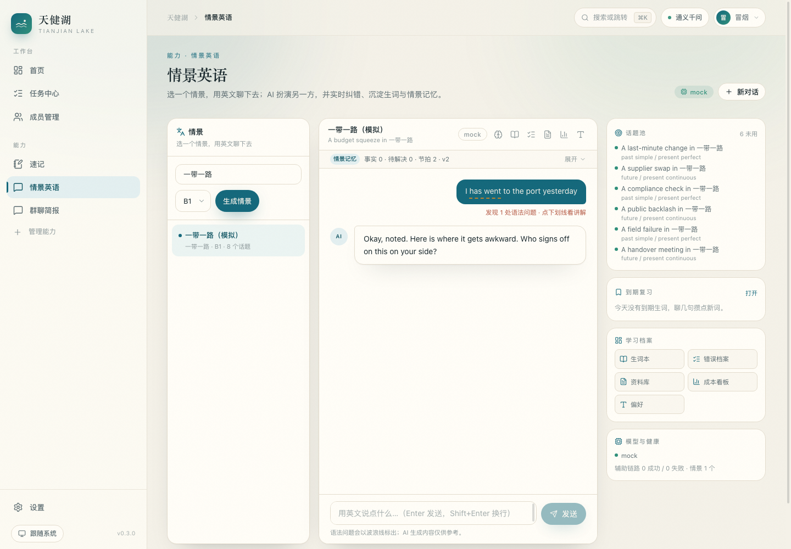
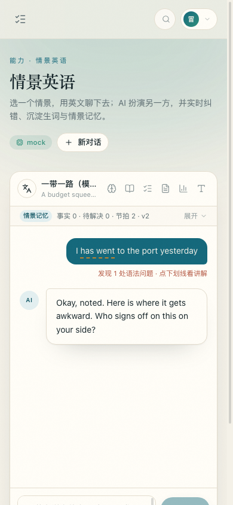

# 天健湖 · Tianjian Lake

> 把教材、通知和记忆，安静地收进一片湖里。

一个**本地优先、多人可用、API Key 自配（OpenAI 兼容）**的教育智能体。
**v0.3.0**：账号体系 + 严格的用户数据隔离 + 统一数据目录；情景式英语对话已作为「情景英语」能力并入主站。


## 现在有什么

| 能力 | 说明 |
|---|---|
| 👥 账号与成员 | 注册 / 登录 / 会话（30 天）、管理员成员管理、开放或关闭注册、重置密码、停用与删除 |
| 🔒 数据隔离 | 供应商与 Key、能力设置、速记、群聊简报、英语学习数据、任务、事件全部按用户隔离，互相不可见 |
| 🗂 统一数据目录 | 所有需要持久化的东西都在仓库根的 `data/`，备份 / 迁移只需打包一个文件夹 |
| 🧩 能力插件系统 | 一个目录 + 一份 manifest = 新能力；导航、路由、设置、Agent 工具自动接入 |
| 🛠 工具注册表 | 能力注册的工具自动进入 `/api/tools`，供后续 Agent 调用（带 user 上下文） |
| 🔐 模型接入 | 每个用户配置自己的 OpenAI 兼容端点，Fernet 加密存储，带连通性测试 |
| ⚙️ 任务中心 | 线程池、进度、取消、SSE 快照，按用户隔离 |
| 📝 速记 | 示例能力，也是新能力的模板（含 Agent 工具 `create_note`） |
| 💬 群聊简报 | 粘贴微信群 / QQ 群聊天记录 → 清洗降噪 → 「一句话 + 重要事项 + 待办 + 日程」，可导出 TXT / MD / ICS / JSON |
| 🗣️ 情景英语 | 输入领域生成情景与话题 → AI 角色扮演英文对话；每轮纠错（19 类闭合错误码）、生词入库、间隔重复、跨会话记忆、资料检索、成本看板 |
| 📚 教材库 | 上传 PDF / EPUB / DOCX / PPTX / TXT / 图片并按课程分类，可设为全站共享；**扫描版 PDF 自动 OCR** 成可检索文本；选定教材提问，AI 只用这本书作答，逐条给出页码/章节，查不到就直说 |
| 📡 校园雷达 | 抓取学校教务处 / 信息公开 / 通知公告，按你的学校、年级、专业、兴趣排序；管理员设抓取间隔或手动更新，结果落库去重；可以直接问「最近有什么比赛」 |

规划中：联想记忆（兴趣化助记 + 遗忘曲线）· 练习场 · 学习台。

## 快速开始

**一条命令，三个平台通用**（macOS / Linux / Windows 都一样）：

```bash
python3 scripts/task.py setup     # 安装依赖
python3 scripts/task.py start     # 启动，打开 http://127.0.0.1:8787
```

Windows 上用 `python scripts\task.py setup`（或 `scripts\task.cmd setup`）。
习惯 shell 的仍然可以 `./scripts/setup.sh`、`./scripts/start.sh`、`make start`——它们都指向同一个实现。

想跳过环境问题直接用 Docker：

```bash
docker compose up -d --build      # 打开 http://127.0.0.1:8787
```

装完先跑一次 `python3 scripts/task.py doctor`，它会告诉你当前平台的 OCR 后端到底是什么。

首次打开会进入登录页：**第一个注册的账号自动成为管理员**。注册分两步——先建账号，
再填学校 / 年级 / 专业 / 兴趣（可跳过）。这些资料用于决定「哪些校园通知跟你有关」。

之后：

1. 在「设置 → 模型接入」填一个 OpenAI 兼容的 Base URL、模型名和 API Key，点「测试连接」；
2. 管理员在「成员管理」里开放注册或直接新建成员；
3. 每个成员登录后都拥有独立的供应商、速记、简报、英语学习数据与任务；
4. 管理员在「校园雷达」页设置抓取间隔，或点「立即更新」；没有外网时可导入示例数据演示。

部署到服务器（Linux systemd / nginx / HTTPS）见 [docs/DEPLOY.md](docs/DEPLOY.md)。

局域网多人使用（同一台机器起服务，其他人用浏览器访问）：

```bash
python3 scripts/task.py start --host 0.0.0.0      # Windows 同样这条命令
```

开发模式（前后端热更新）：`python3 scripts/task.py dev`；环境自检：`python3 scripts/task.py doctor`。
POSIX 上 `make dev` / `make doctor` 是等价快捷方式。

## 数据都在 `data/`

所有需要持久化的内容都放在仓库根的 **`data/`**，代码目录里不再散落运行时文件：

```
data/
├── app.db          SQLite 主库（账号、会话、供应商、速记、简报、英语学习数据、教材与索引、校园通知、任务、事件）
├── secret.key      API Key 加密密钥（务必备份，丢了已存 Key 解不开）
├── uploads/        教材库上传的原始文件
└── cache/          OCR 工具、解析与模型响应缓存
```

- **备份**：`python3 scripts/task.py backup`（打包到 `backups/`，跨平台，不依赖 tar）；换电脑把整个 `data/` 搬过去即可。
- **重置**：`make reset-data FORCE=1`（清空账号与数据，下次启动自动重建）。
- **换位置**：`TJH_DATA_DIR=/srv/tianjianhu-data python3 scripts/task.py start`；
  Windows 用 `set TJH_DATA_DIR=D:\tianjianhu-data` 后再启动。
- **GitHub 协作**：`data/` 与 `.env` 已在 `.gitignore` 排除，只共享代码；每个人本地跑自己的实例，数据互不影响。

## 界面

| 成员管理（管理员） | 速记 |
|---|---|
|  |  |

| 首页（登录后） | 深色主题 |
|---|---|
|  |  |

| 情景英语（桌面） | 情景英语（移动端） |
|---|---|
|  |  |

## 目录结构

```
apps/server/          FastAPI 后端
├── app/core/         认证、能力发现、工具注册、LLM 客户端、任务中心、加密
├── app/api/          auth / users / system / providers / jobs / settings
├── app/capabilities/ 能力插件（notes、wechat_digest、english）
└── app/cli.py        run / doctor / migrate / new-capability / 用户管理
apps/web/             React + Vite + Tailwind v4 前端
├── src/app/          布局、导航、命令面板、路由
├── src/components/   设计系统与业务组件
├── src/pages/        登录、首页、设置、任务、成员管理、404
└── src/capabilities/ 前端能力注册表与页面
data/                 唯一的运行期数据目录（不提交）
docs/                 全部文档（入口：docs/README.md）
scripts/              task.py（跨平台入口）+ setup/start/dev 的 sh 包装 + Windows 的 task.cmd
deploy/               nginx 配置（macOS/Linux）、systemd 服务、安装脚本
Dockerfile            跨平台镜像（前端构建 + Python 运行时 + tesseract）
```

## 账号与权限

| 角色 | 能做什么 |
|---|---|
| 管理员 | 成员管理（新建 / 重置密码 / 停用 / 删除 / 改角色）、开放或关闭注册、查看成员数据量 |
| 成员 | 使用全部已启用能力；只能看到与修改自己的数据 |

- 密码使用 `hashlib.scrypt` 加盐哈希；会话是随机 token，库里只存 `sha256(token)`。
- Cookie 为 `HttpOnly + SameSite=Lax`；放到 HTTPS 后设置 `TJH_COOKIE_SECURE=true`。
- 登录失败有频率限制（默认 5 分钟内 8 次）。
- 停用账号或重置密码会立即让该用户已登录的会话失效。

## 新增一个能力

```bash
cd apps/server
.venv/bin/python -m app.cli new-capability flashcards --name 记忆卡 --icon brain --order 20
```

会同时生成后端能力目录（路由、工具、迁移）和前端页面目录；重启后侧栏出现新能力，`/api/tools` 多一个工具。协议细节见 [docs/FRAMEWORK.md](docs/FRAMEWORK.md)。

## 文档

**完整文档索引：[docs/README.md](docs/README.md)** —— 每篇文档的路径、内容、适合谁读、
是否与当前代码同步，都在那里。从这里按目的选阅读路径，不用读完全部。

最常被用到的几篇：

| 文档 | 内容 |
|---|---|
| [docs/FRAMEWORK.md](docs/FRAMEWORK.md) | 框架实现：认证、能力协议、工具、迁移、API、如何接入新能力 |
| [docs/DESIGN.md](docs/DESIGN.md) | 产品构想与设计推演（含未实现模块），回答「为什么这么设计」 |
| [docs/LIBRARY.md](docs/LIBRARY.md) · [docs/ENGLISH.md](docs/ENGLISH.md) · [docs/WECHAT-DIGEST.md](docs/WECHAT-DIGEST.md) | 三个能力的契约与实现说明 |
| [docs/DEPLOY.md](docs/DEPLOY.md) | 部署上线步骤 + 上线安全清单 |
| [docs/CLEANUP.md](docs/CLEANUP.md) | 本轮整理记录：状态标注修正、隐私清理、安全加固与上线影响 |

## 技术栈

React 19 · TypeScript · Vite · Tailwind CSS v4 · Zustand · Radix · lucide-react
FastAPI · SQLModel · SQLite（WAL）· Pydantic · OpenAI SDK · Fernet · scrypt
教材 / 资料解析：python-docx · python-pptx · pypdf · pdfplumber · EbookLib · BeautifulSoup · trafilatura
间隔重复：FSRS-lite（情景英语生词排程）

## 免责声明

仅用于个人与团队学习；数据保存在你部署的机器上；爬虫能力只抓公开页面、低频只读、不绕过访问控制；上传教材请自行确认版权范围，请勿分发。
