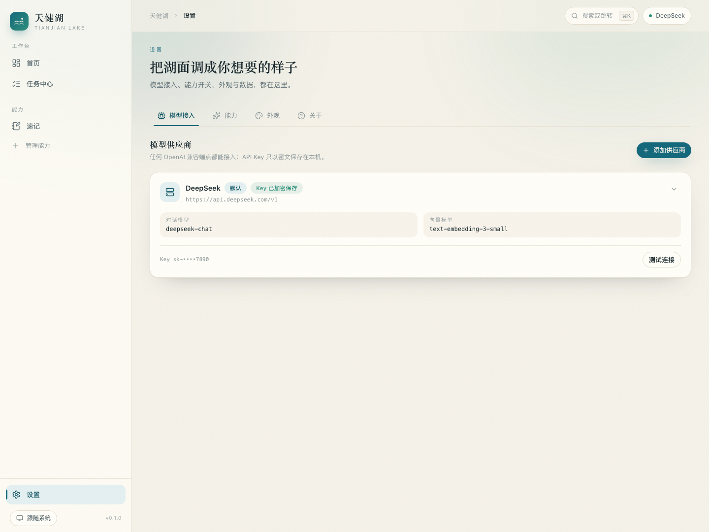

# 天健湖 · Tianjian Lake

> 把教材、通知和记忆，安静地收进一片湖里。

一个**本地优先、单进程可跑、API Key 自配（OpenAI 兼容）**的教育智能体。
当前是 **v0.1.0 总体框架版**：内核、能力插件、工具注册、模型接入、设置与设计系统已经就绪，教材库 / 校园雷达 / 联想记忆等能力会按同一套协议逐个接入。


## 现在有什么

| 已落地（框架） | 说明 |
|---|---|
| 🧩 能力插件系统 | 一个目录 + 一份 manifest = 新能力；导航、路由、设置、Agent 工具自动接入 |
| 🛠 工具注册表 | 能力注册的工具自动进入 `/api/tools`，供后续 Agent 调用 |
| 🔐 模型接入 | OpenAI 兼容端点（DeepSeek / Kimi / 通义 / 硅基流动 / OpenAI / Ollama），Key 本机加密、带连通性测试 |
| 🗄 SQLite + 迁移 | 核心表 + 每能力自带 SQL 迁移，单文件可备份 |
| ⚙️ 任务中心 | 线程池、进度、取消、SSE 实时快照，给解析/抓取/嵌入这类耗时活儿用 |
| 🎨 设计系统 | 米白纸感 + 湖蓝、明暗主题、⌘K 命令面板、模态/通知/空状态/动效 |
| 📝 速记能力 | 示例能力，同时也是新能力的模板（含 Agent 工具 `create_note`） |

规划中：教材库（Word/PPT/PDF/EPUB 解析与引用问答）· 校园雷达（教务处通知抓取）· 联想记忆（兴趣化助记 + 遗忘曲线）· 练习场 · 学习台。

## 快速开始

```bash
# 1. 安装依赖（首次会自动建 Python venv 与前端 node_modules）
./scripts/setup.sh

# 2. 启动（首次会自动构建前端）
./scripts/start.sh
```

打开 **http://127.0.0.1:8787** ，在「设置 → 模型接入」里填一个 OpenAI 兼容的 Base URL、模型名和 API Key，点「测试连接」。

开发模式（前后端热更新）：

```bash
make dev     # 后端 8787 + 前端 5174
```

环境自检：

```bash
make doctor
```

## 界面

| 深色主题 | 速记（示例能力） |
|---|---|
|  |  |

| 模型接入 | 能力管理 |
|---|---|
|  | 设置 → 能力（开关 + 由 schema 自动渲染的设置表单） |

## 目录结构

```
apps/server/          FastAPI 后端
├── app/core/         能力发现、工具注册、LLM 客户端、任务中心、加密
├── app/api/          系统、供应商、任务、设置接口
├── app/capabilities/ 能力插件（notes 为示例）
└── app/cli.py        run / doctor / migrate / new-capability
apps/web/             React + Vite + Tailwind v4 前端
├── src/app/          布局、导航、命令面板、路由
├── src/components/   设计系统与业务组件
├── src/pages/        首页、设置、任务、404
└── src/capabilities/ 前端能力注册表与页面
docs/                 设计文档与验证记录
scripts/              setup / start / dev
```

## 新增一个能力

```bash
cd apps/server
.venv/bin/python -m app.cli new-capability flashcards --name 记忆卡 --icon brain --order 20
```

会同时生成后端能力目录（含路由、工具、迁移）和前端页面目录；重启后侧栏出现「记忆卡」，`/api/tools` 多一个 `flashcards_ping` 工具。协议细节见 [docs/FRAMEWORK.md](docs/FRAMEWORK.md)。

## 文档

| 文档 | 内容 |
|---|---|
| [docs/DESIGN.md](docs/DESIGN.md) | 产品构想 + 技术设计（架构、数据模型、API、扩展性、路线图） |
| [docs/FRAMEWORK.md](docs/FRAMEWORK.md) | 当前框架的实现说明：能力协议、工具、迁移、CLI、API |
| [docs/VERIFICATION.md](docs/VERIFICATION.md) | 后端依赖 / 四种教材格式解析 / FTS5 + 混合检索实测 |
| [docs/VERIFICATION-CRAWLER.md](docs/VERIFICATION-CRAWLER.md) | 8 所高校教务处通知页抓取可行性实测 |

## 技术栈

React 19 · TypeScript · Vite · Tailwind CSS v4 · Zustand · Radix Dialog/Switch · lucide-react
FastAPI · SQLModel · SQLite（WAL）· Pydantic · OpenAI SDK · Fernet 加密
规划中：python-docx / python-pptx / pypdf / ebooklib / trafilatura / jieba / FSRS

## 免责声明

仅用于个人学习；数据保存在本机；后续爬虫能力只抓公开页面、低频只读、不绕过访问控制；上传教材请自行确认版权范围，请勿分发。
