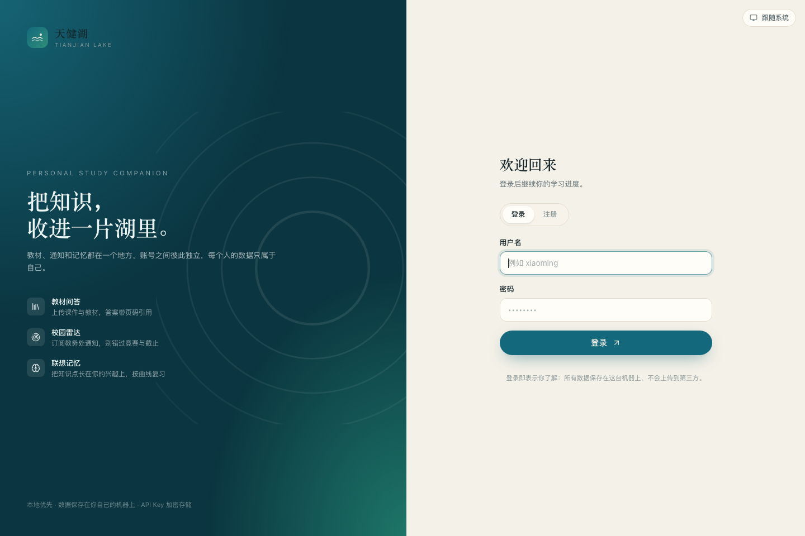
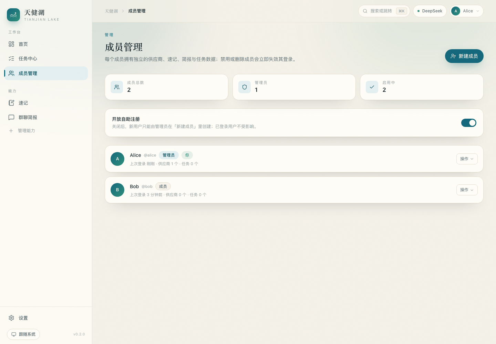
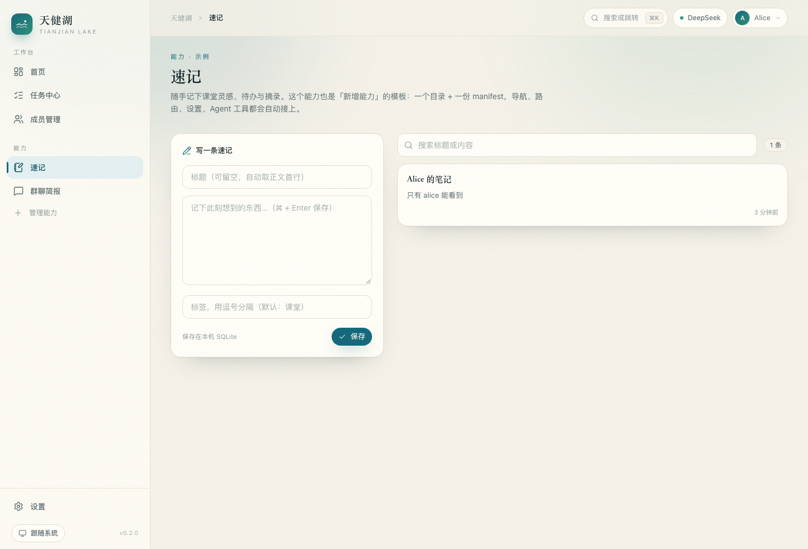
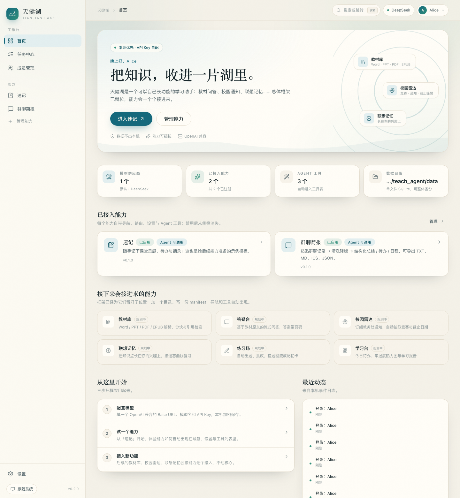
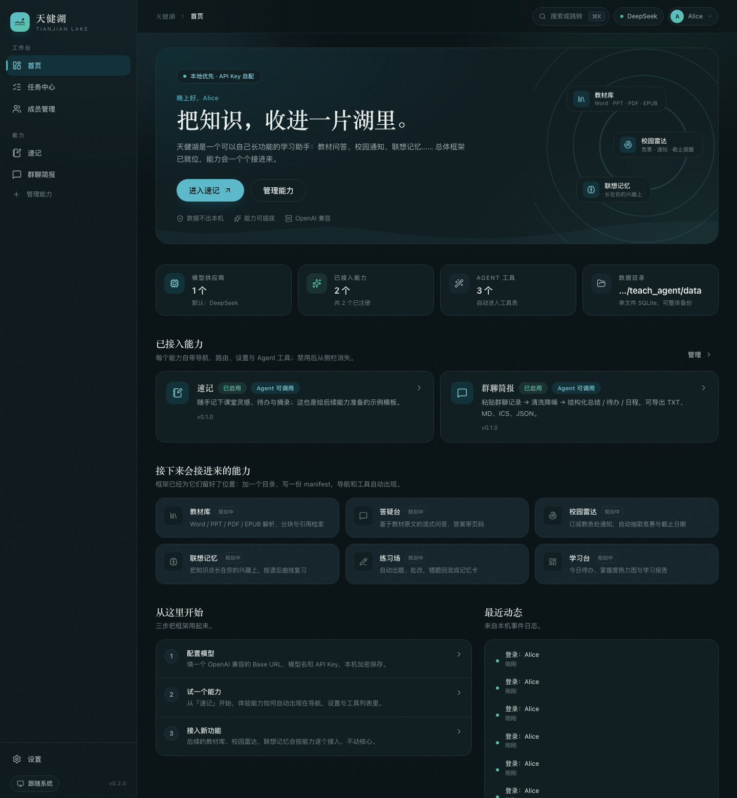

# 天健湖 · Tianjian Lake

> 把教材、通知和记忆，安静地收进一片湖里。

一个**本地优先、多人可用、API Key 自配（OpenAI 兼容）**的教育智能体。
**v0.2.0**：账号体系 + 严格的用户数据隔离 + 统一数据目录，框架与插件机制保持不变。



## 现在有什么

| 能力 | 说明 |
|---|---|
| 👥 账号与成员 | 注册 / 登录 / 会话（30 天）、管理员成员管理、开放或关闭注册、重置密码、停用与删除 |
| 🔒 数据隔离 | 供应商与 Key、能力设置、速记、群聊简报、任务、事件全部按用户隔离，互相不可见 |
| 🗂 统一数据目录 | 所有需要持久化的东西都在仓库根的 `data/`，备份 / 迁移只需打包一个文件夹 |
| 🧩 能力插件系统 | 一个目录 + 一份 manifest = 新能力；导航、路由、设置、Agent 工具自动接入 |
| 🛠 工具注册表 | 能力注册的工具自动进入 `/api/tools`，供后续 Agent 调用（带 user 上下文） |
| 🔐 模型接入 | 每个用户配置自己的 OpenAI 兼容端点，Fernet 加密存储，带连通性测试 |
| ⚙️ 任务中心 | 线程池、进度、取消、SSE 快照，按用户隔离 |
| 📝 速记 | 示例能力，也是新能力的模板（含 Agent 工具 `create_note`） |
| 💬 群聊简报 | 粘贴微信群 / QQ 群聊天记录 → 清洗降噪 → 「一句话 + 重要事项 + 待办 + 日程」，可导出 TXT / MD / ICS / JSON |

规划中：教材库（Word/PPT/PDF/EPUB 解析与引用问答）· 校园雷达（教务处通知抓取）· 联想记忆（兴趣化助记 + 遗忘曲线）· 练习场 · 学习台。

## 快速开始

```bash
./scripts/setup.sh     # 安装依赖（首次）
./scripts/start.sh     # 启动，打开 http://127.0.0.1:8787
```

首次打开会进入登录页：**第一个注册的账号自动成为管理员**。之后：

1. 在「设置 → 模型接入」填一个 OpenAI 兼容的 Base URL、模型名和 API Key，点「测试连接」；
2. 管理员在「成员管理」里开放注册或直接新建成员；
3. 每个成员登录后都拥有独立的供应商、速记、简报与任务。

局域网多人使用（同一台机器起服务，其他人用浏览器访问）：

```bash
HOST=0.0.0.0 PORT=8787 ./scripts/start.sh
```

开发模式（前后端热更新）：`make dev`；环境自检：`make doctor`。

## 数据都在 `data/`

所有需要持久化的内容都放在仓库根的 **`data/`**，代码目录里不再散落运行时文件：

```
data/
├── app.db          SQLite 主库（账号、会话、供应商、速记、简报、任务、事件）
├── secret.key      API Key 加密密钥（务必备份，丢了已存 Key 解不开）
├── uploads/        后续教材库上传的原始文件
└── cache/          解析与模型响应缓存
```

- **备份**：`make backup`（打包到 `backups/`）；换电脑把整个 `data/` 搬过去即可。
- **重置**：`make reset-data FORCE=1`（清空账号与数据，下次启动自动重建）。
- **换位置**：`TJH_DATA_DIR=/srv/tianjianhu-data ./scripts/start.sh`。
- **GitHub 协作**：`data/` 与 `.env` 已在 `.gitignore` 排除，只共享代码；每个人本地跑自己的实例，数据互不影响。

## 界面

| 成员管理（管理员） | 速记 |
|---|---|
|  |  |

| 首页（登录后） | 深色主题 |
|---|---|
|  |  |

## 目录结构

```
apps/server/          FastAPI 后端
├── app/core/         认证、能力发现、工具注册、LLM 客户端、任务中心、加密
├── app/api/          auth / users / system / providers / jobs / settings
├── app/capabilities/ 能力插件（notes、wechat_digest）
└── app/cli.py        run / doctor / migrate / new-capability / 用户管理
apps/web/             React + Vite + Tailwind v4 前端
├── src/app/          布局、导航、命令面板、路由
├── src/components/   设计系统与业务组件
├── src/pages/        登录、首页、设置、任务、成员管理、404
└── src/capabilities/ 前端能力注册表与页面
data/                 唯一的运行期数据目录（不提交）
docs/                 设计文档、框架说明、验证记录
scripts/              setup / start / dev
```

## 账号与权限

| 角色 | 能做什么 |
|---|---|
| 管理员 | 成员管理（新建 / 重置密码 / 停用 / 删除 / 改角色）、开放或关闭注册、查看成员数据量 |
| 成员 | 使用全部已启用能力；只能看到与修改自己的数据 |

- 密码使用 `hashlib.scrypt` 加盐哈希；会话是随机 token，库里只存 `sha256(token)`。
- Cookie 为 `HttpOnly + SameSite=Lax`；放到 HTTPS 后设置 `TJH_COOKIE_SECURE=true`。
- 登录失败有频率限制（默认 5 分钟内 8 次）。
- 停用账号或重置密码会立即让该用户已登录的会话失效。

## 新增一个能力

```bash
cd apps/server
.venv/bin/python -m app.cli new-capability flashcards --name 记忆卡 --icon brain --order 20
```

会同时生成后端能力目录（路由、工具、迁移）和前端页面目录；重启后侧栏出现新能力，`/api/tools` 多一个工具。协议细节见 [docs/FRAMEWORK.md](docs/FRAMEWORK.md)。

## 文档

| 文档 | 内容 |
|---|---|
| [docs/DESIGN.md](docs/DESIGN.md) | 产品构想 + 技术设计（架构、数据模型、API、扩展性、路线图） |
| [docs/FRAMEWORK.md](docs/FRAMEWORK.md) | 框架实现说明：认证、能力协议、工具、迁移、CLI、API |
| [docs/WECHAT-DIGEST.md](docs/WECHAT-DIGEST.md) | 群聊简报能力的实现契约与数据格式 |
| [docs/VERIFICATION.md](docs/VERIFICATION.md) | 后端依赖 / 四种教材格式解析 / FTS5 + 混合检索实测 |
| [docs/VERIFICATION-CRAWLER.md](docs/VERIFICATION-CRAWLER.md) | 8 所高校教务处通知页抓取可行性实测 |

## 技术栈

React 19 · TypeScript · Vite · Tailwind CSS v4 · Zustand · Radix · lucide-react
FastAPI · SQLModel · SQLite（WAL）· Pydantic · OpenAI SDK · Fernet · scrypt
规划中：python-docx / python-pptx / pypdf / ebooklib / trafilatura / jieba / FSRS

## 免责声明

仅用于个人与团队学习；数据保存在你部署的机器上；爬虫能力只抓公开页面、低频只读、不绕过访问控制；上传教材请自行确认版权范围，请勿分发。
