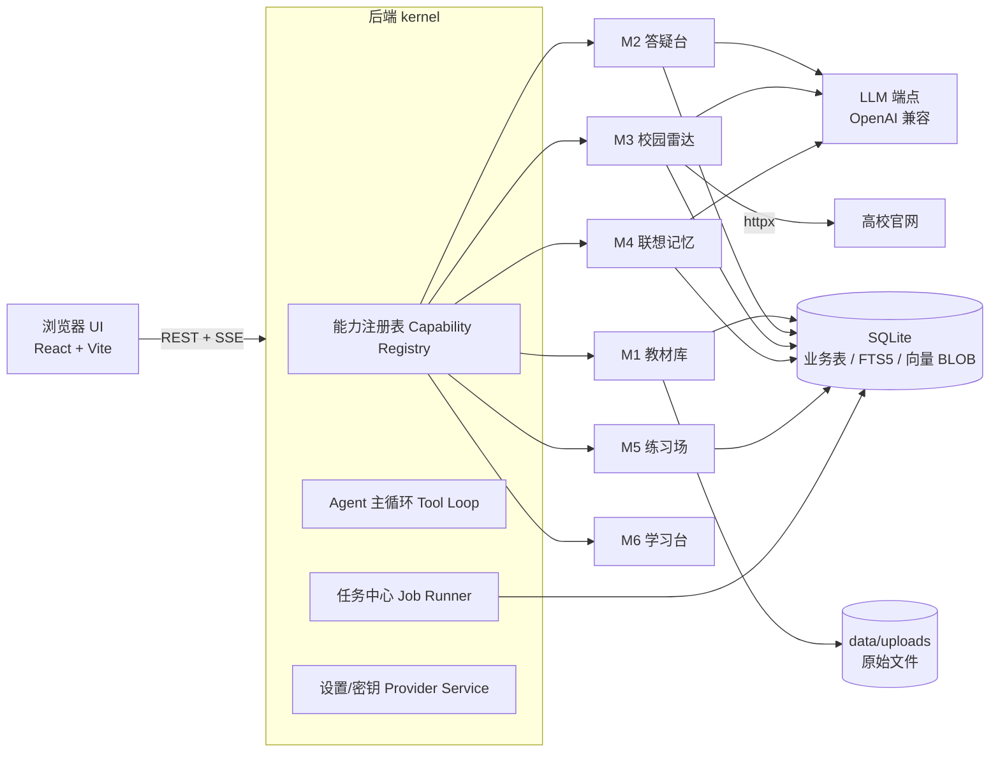

# 天健湖 Tianjian Lake · 教育智能体
## 产品构想与实施设计 v0.1

> 一句话：**把教材、通知和记忆，安静地收进一片湖里。**
> 本地优先、单进程可跑、API Key 自配（OpenAI 兼容协议）、能力可插拔。

---

## 0. 一页速览

| 维度 | 结论 |
|---|---|
| 形态 | 本地优先的 Web 应用（浏览器打开），单进程启动，数据全部在本地 `apps/server/data/` |
| 前端 | React 19 + TypeScript + Vite + Tailwind v4 + Radix/shadcn 风格组件 + framer-motion |
| 后端 | Python 3.11 + FastAPI + SQLModel + SQLite（FTS5 + 向量暴力检索） |
| 模型 | 任意 OpenAI 兼容端点（DeepSeek / OpenAI / Kimi / 通义 / 硅基流动 / Ollama…），填 baseURL + model + key |
| 检索 | 混合检索：全文 BM25（FTS5+jieba）+ 向量余弦，RRF 融合，回答带**页码/幻灯片号引用** |
| 爬虫 | 「校园雷达」：订阅各高校教务处通知公告页，LLM 结构化抽取竞赛/讲座/考试/截止日期 |
| 记忆 | 「联想记忆」：读取你的喜好档案 → 生成专属记忆卡 → FSRS 间隔复习 + 主动回忆 |
| 扩展性 | **能力（Capability）插件化**：后端一个目录 + 前端一个目录 = 新功能；CLI 一键脚手架；工具自动进入 Agent 可调用列表；可选 MCP 互通 |
| 首版闭环 | 上传 docx → 提问 → 流式回答 + 引用定位（下一步接入） |
| 当前进度 | **v0.1.0 框架版已落地**：内核、能力插件、工具注册、迁移、任务中心、设置/模型接入、设计系统与前端骨架（详见 `docs/FRAMEWORK.md`） |

---

## 1. 产品构想

### 1.1 目标用户与真实痛点

用户画像：中国大学生（本/硕），期末靠背书，信息获取靠翻各个学校官网。

| 痛点 | 现状 | 天健湖的解法 |
|---|---|---|
| 教材太厚，复习找不到重点 | 通读 PPT/PDF，效率低，问通用 AI 又答不对课本 | 上传教材 → 基于原文回答 + 精确引用，可圈定「只查第 3 章」 |
| 竞赛/通知散落在十几个官网 | 每天手动刷，容易错过报名截止 | 订阅教务处的通知列表 → 自动抓取、结构化、按兴趣过滤、到期提醒 |
| 背书枯燥、记不住 | 死记硬背、艾宾浩斯坚持不下来 | 把知识点映射到**你喜欢的游戏/动漫/音乐/梗**上，生成画面和口诀，按遗忘曲线复习 |
| 不知道掌握得怎样 | 自我感觉良好，一考就露馅 | 自动出题 + 掌握度热力图 + 错题本回流记忆卡 |
| 工具太多、数据割裂 | 笔记一个 App、PDF 一个、Anki 一个 | 教材、通知、记忆卡、错题在同一个库，Agent 能跨模块调用 |

### 1.2 产品定位

- **不是**「又一个 ChatGPT 套壳」：它是**有教材原文、有你个人偏好、有你学校通知**的私人助教。
- **不是**「重型 SaaS」：单用户、本地运行、零运维，一条命令启动。
- 三个差异化：
  1. **引用可信**：每个答案都能点回教材第几页/第几张幻灯片。
  2. **长在你的兴趣上**：喜好档案贯穿联想记忆、举例风格、出题口味。
  3. **可长出来的产品**：能力插件化，加一个功能 = 加一个目录，不用改核心。

### 1.3 六大能力模块

| 模块 | 名称 | 关键能力 |
|---|---|---|
| M1 | **教材库** Library | 上传 docx/pptx/pdf/epub/md/txt/网页；解析、分块、索引；后台任务进度；按课程归类；章节树与原文预览 |
| M2 | **答疑台** Tutor | 多轮对话；混合检索 + 引用；范围限定（全书/某课程/某章）；快捷动作（讲简单点 / 举个例子 / 考考我 / 画个表）；苏格拉底引导模式；流式输出 |
| M3 | **校园雷达** Radar | 订阅教务处/研究生院/信息公开网的通知列表；定时抓取；LLM 抽字段（类型/截止/面向对象/摘要）；过滤+日历+提醒；「我能不能参加 / 怎么准备」一键问 Agent |
| M4 | **联想记忆** Mnemonic | 喜好画像；知识点抽取；个性化记忆卡（画面/故事/口诀）；FSRS 复习队列；填空/遮挡/自测；记忆曲线与遗忘预警；导出 Anki/Markdown |
| M5 | **练习场** Practice | 依据教材自动出题（选择/填空/名词解释/简答）；LLM 按评分细则批改；错题本 → 自动回流成记忆卡 |
| M6 | **学习台** Dashboard | 今日待办（待复习/新通知/待续对话）；掌握度热力图；连续学习天数；学习报告 |

横切面：**设置**（模型与 Key、能力开关、数据管理、外观）、**命令面板 ⌘K**、**全局搜索**、**任务中心**（所有后台任务的统一进度）。

### 1.4 三个核心场景剧本

**剧本 A · 期末前夜**
1. 拖入《计算机网络》PPT 和老师的 PDF 习题 → 教材库显示解析进度，30 秒后可查。
2. 问：「TCP 三次握手为什么不能是两次？用我能听懂的话说。」→ 流式回答，右下角引用面板列出 2 个片段（PPT 第 42 页 / PDF 第 7 页），点击跳转原文并高亮。
3. 点「考考我」→ 3 道选择题，答错 1 道 → 自动进错题本，并生成 1 张记忆卡进复习队列。

**剧本 B · 找比赛**
1. 在雷达里粘贴「XX 大学教务处 - 通知公告」链接 → 系统自动探测列表结构，预览前 10 条，确认订阅。
2. 次日起，每天早上抓取增量；LLM 把《关于举办第 X 届大学生数学建模竞赛的通知》抽成：`类别=竞赛｜截止=2026-11-03｜面向=本科生｜报名=链接`。
3. 首页卡片「新增 3 条与你相关」；点开问：「这个比赛我大二能参加吗？需要准备什么？」→ Agent 调 `get_notice` + `search_library` + 你的年级档案作答。

**剧本 C · 背 800 个名词**
1. 首次使用时录入喜好：原神、三国、周杰伦、冷笑话；忌讳：不要恐怖元素。
2. 选「第 5 章 传输层」→ 抽取 24 个知识点 → 生成卡片：
   - 正：**为什么 TIME_WAIT 要等 2MSL？** 反：确保最后一个 ACK 到达 + 让旧报文消散。
   - 联想：「像**钟离**放完大招不会马上离场，要等护盾（ACK）确认到场，再站 2 个 MSL 才收工。」
3. 每天打开复习，卡片翻面、自评「忘了/困难/记得/太简单」→ FSRS 自动排下次；一周后遗忘曲线可视化。
4. 考前导出 Markdown 打印版或 .apkg 进 Anki。

### 1.5 信息架构与线框图

导航（左侧 rail，图标 + 文字，可折叠；移动端底部 Tab）：

```
教材库 · 答疑台 · 校园雷达 · 联想记忆 · 练习场 · 学习台 —— 底部：设置 / 任务中心
```

**首页 / 学习台**
```
┌────────────────────────────────────────────────────────────────────┐
│ 天健湖        ⌘K 全局搜索…            ☾ 主题   ⚙ 设置    (头像)      │
├──────────┬─────────────────────────────────────────────────────────┤
│ 📚 教材库 │ 10月22日 周四 · 连续学习 12 天          [ + 新建对话 ]   │
│ 💬 答疑台 │ ┌────────────┐┌────────────┐┌────────────┐┌──────────┐ │
│ 📡 校园雷达│ │ 待复习 23  ││ 新通知 5   ││ 错题 8     ││ 本周 68% │ │
│ 🧠 联想记忆│ └────────────┘└────────────┘└────────────┘└──────────┘ │
│ ✏️ 练习场 │ 继续上次：《计算机网络》第 4 章            [继续 →]    │
│ 📊 学习台 │ 今日通知 · 与你相关                                     │
│          │ · 数学建模竞赛报名（截止 11-03）  [竞赛] [报名] [问问]  │
│  ─────── │ · 期中教学检查通知（10-30）       [通知] [详情]         │
│ ⚙ 设置   │ 掌握度热力图 ▓▓▓▓▓░░░  本学期 6 门课                    │
└──────────┴─────────────────────────────────────────────────────────┘
```

**答疑台**
```
┌──────────────────────────────────────────────────────────┬──────────┐
│ 《计算机网络》 ▾   范围：全书 / 第4章 ▾    模型：DeepSeek ▾│ 引用 (2) │
├──────────────────────────────────────────────────────────┤ ① PPT 42 │
│ 你：三次握手为什么不能是两次？                            │   "SYN..." │
│                                                          │ ② PDF 7  │
│ 天健湖：因为两次握手无法确认「客户端收到了服务端的确认」…   │   "…"     │
│  ▎ 所以需要第三次 ACK 让服务端确认[1][2]。                │           │
│  ┌ 追问：讲简单点 · 举个例子 · 考考我 · 生成表格 ┐        │           │
├──────────────────────────────────────────────────────────┤           │
│ [ 输入问题…                                      ⏎ 发送 ]│           │
└──────────────────────────────────────────────────────────┴──────────┘
```

**联想记忆（复习态）**
```
┌───────────────────────────────────────────────────────────┐
│ 今日复习 12 / 23        剩余 8 张 · 预计 6 分钟           │
│ ┌───────────────────────────────────────────────────────┐ │
│ │  为什么 TIME_WAIT 要等 2MSL？                          │ │
│ │                                                       │ │
│ │            （点击卡片或按空格翻面）                    │ │
│ └───────────────────────────────────────────────────────┘ │
│  [ 忘了 ]   [ 困难 ]   [ 记得 ]   [ 太简单 ]   ← FSRS 自评 │
└───────────────────────────────────────────────────────────┘
翻面后：
│ 答案：确保最后 ACK 抵达 + 让旧报文在网络中消散           │
│ 🧠 联想：钟离大招后不立刻离场，等护盾(ACK)确认再站 2 MSL  │
│ 📖 原文：PPT 第 42 页《TCP 连接管理》                     │
```

### 1.6 视觉与交互规范

- **气质**：学术但不古板 —— 米白纸感 + 靛蓝墨色 + 琥珀强调，圆角 12–16px，柔和阴影，细颗粒噪声背景。
- **色板**：纸白 `#FBF9F5`、墨 `#1F2933`、主靛 `#2F5D8C`、强调琥珀 `#E0A33E`、成功 `#2F8F6B`、危险 `#C0504D`；暗色 `#12161C / #E8E6E1`。
- **字体**：UI 用系统无衬线（`-apple-system/PingFang SC`），标题可选「霞鹜文楷」懒加载；正文 15px / 行高 1.75。
- **动效**：页面淡入 + 卡片轻微上浮；流式光标；卡片 3D 翻面 400ms；引文面板滑出。全部尊重 `prefers-reduced-motion`。
- **可用性**：⌘K 命令面板、全键盘可达、对比度 ≥ AA、空状态有引导（不是空白页）、所有耗时操作有进度与可取消。
- **响应式**：≥1280 三栏；768–1280 两栏（引用抽屉浮层）；<768 单栏 + 底部 Tab。

---

## 2. 技术架构

### 2.1 总体架构



要点：
1. **一个进程**：生产模式 FastAPI 直接托管构建后的前端静态文件；开发模式 Vite 代理 `/api`。
2. **一个库**：SQLite（WAL）放业务数据、FTS5 索引、向量 BLOB。学生规模（几万 chunk）用 **numpy 暴力余弦**：实测 1 万块 × 1024 维余弦 0.6–0.7ms，FTS5+向量+RRF 混合检索端到端 **1.9ms**，完全不需要向量数据库。
3. **一个出口**：所有模型调用走统一 `LLMClient`（OpenAI SDK，`base_url` 可配），便于换供应商、做成本统计与重试。
4. **所有耗时任务进任务中心**：解析/嵌入/爬取/出题都是 job，前端统一进度条 + 可取消。

### 2.2 技术选型与理由

| 层 | 选择 | 为什么 |
|---|---|---|
| 后端语言 | Python 3.11 | 教材解析生态最好（python-docx / python-pptx / pypdf+pypdfium / ebooklib / trafilatura）；3.11 兼容性最稳 |
| Web 框架 | FastAPI + Uvicorn | 原生异步、Pydantic 校验、SSE 简单 |
| ORM | SQLModel（SQLAlchemy 2 + Pydantic v2） | 单文件定义模型与 schema，够用且轻 |
| 数据库 | SQLite（WAL）+ FTS5 | 零运维、单文件、可备份；FTS5 内置 BM25 |
| 切词 | jieba | 中文 FTS 需要预切词写入影子列 |
| 向量 | numpy 暴力余弦（可选 sqlite-vec） | 1 万块 × 1024 维 ≈ 0.6ms；避免引入 Milvus/Chroma 的运维负担 |
| 文档解析 | python-docx / python-pptx / pypdf→pdfplumber→pypdfium2 / ebooklib+bs4 / markdownify | 覆盖 docx/pptx/pdf/epub/md/html，且能保留页码、幻灯片号、标题层级 |
| 爬虫 | httpx + lxml/selectolax + trafilatura（Playwright 仅兜底） | 8 所高校实站实测：列表页 8/8 静态、零配置启发式 15/15 命中、正文抽取 6/6 成功 → 纯 HTTP 覆盖 85%–90%（见 `docs/VERIFICATION-CRAWLER.md`） |
| 调度 | APScheduler（进程内） | 定时抓取、到期提醒，无需 Redis/Celery |
| 密钥 | cryptography.Fernet + 本机密钥文件 | API Key 加密落库，不写明文 |
| 前端 | React 19 + TS + Vite + Tailwind v4 + Radix + lucide + framer-motion + zustand + react-markdown + KaTeX + recharts | 生态成熟、体积可控、能做细腻动效；公式与图表开箱即用（本机已实测：React 19.3 / Vite 8.3 / Tailwind 4.3 安装正常） |
| 测试 | pytest + httpx.AsyncClient / vitest | 后端契约 + 前端组件 |
| 版本策略 | 后端锁 `requirements.txt`，前端锁 `pnpm-lock.yaml` | 可复现；升级走显式 PR |
| 打包 | `./scripts/dev.sh`（双进程）/ `./scripts/start.sh`（单进程）+ Dockerfile | 学生一条命令能跑起来 |

**已在本机（macOS / Python 3.11.17 / SQLite 3.53.4）实测通过**：`fastapi 0.159.1`、`sqlmodel 0.0.48`、`pypdf 6.21.2`、`pdfplumber 0.11.10`、`python-docx 1.2.0`、`python-pptx 1.0.2`、`ebooklib 0.20`、`trafilatura 2.3.1`、`selectolax 1.0.1`、`openai 3.36.1`、`numpy 2.4.6`、`jieba 0.42.1`、`sqlite-vec 0.1.9` 全部一次安装成功；FTS5 与 sqlite-vec 均可加载；四种格式解析样例均已验证（详见 `docs/VERIFICATION.md`）。

**为什么不是全栈 Node？** PDF/PPTX/EPUB 的高保真解析、中文正文抽取、后续可能的 OCR，Python 生态明显更稳。
**为什么不是向量数据库？** 单用户数据量小；SQLite + numpy 少一个服务、少一处故障点，且备份就是一个文件。数据量增长后再切 sqlite-vec/远端向量库，接口已抽象。

### 2.3 仓库结构

```
teach_agent/
├── apps/
│   ├── server/                        # Python 后端
│   │   ├── app/
│   │   │   ├── main.py                # 应用装配：路由 / 静态托管 / 启动钩子
│   │   │   ├── config.py              # 设置（环境变量 + data/config.json）
│   │   │   ├── db.py                  # 引擎 / 会话 / 迁移
│   │   │   ├── models.py              # 核心表
│   │   │   ├── core/
│   │   │   │   ├── llm.py             # OpenAI 兼容客户端（chat/embed/流式/工具调用/重试/计费）
│   │   │   │   ├── crypto.py          # Fernet 密钥加解密
│   │   │   │   ├── jobs.py            # 任务中心（线程池 + 状态机 + 进度）
│   │   │   │   ├── sse.py             # SSE 事件协议
│   │   │   │   ├── retrieval.py       # FTS5 + 向量 + RRF + 重排
│   │   │   │   ├── chunking.py        # 标题感知分块
│   │   │   │   ├── agent.py           # Agent 工具循环
│   │   │   │   ├── tools.py           # 工具注册表
│   │   │   │   └── capability.py      # 能力插件协议与发现
│   │   │   ├── capabilities/
│   │   │   │   ├── library/           # M1 教材库（路由+服务+工具）
│   │   │   │   ├── tutor/             # M2 答疑台
│   │   │   │   ├── radar/             # M3 校园雷达（适配器/抓取/抽取/提醒）
│   │   │   │   ├── mnemonic/          # M4 联想记忆（画像/生成/FSRS）
│   │   │   │   ├── practice/          # M5 练习场
│   │   │   │   └── dashboard/         # M6 学习台
│   │   │   ├── parsers/               # docx/pptx/pdf/epub/md/html → 带位置文本
│   │   │   └── cli.py                 # new-capability / migrate / doctor
│   │   ├── tests/
│   │   └── pyproject.toml
│   └── web/                           # React 前端
│       ├── src/
│       │   ├── app/                   # 路由、布局、导航、命令面板
│       │   ├── components/ui/         # 设计系统（Button/Card/Dialog/Toast/Empty…）
│       │   ├── components/            # 业务通用（引用面板、任务进度、Markdown、公式）
│       │   ├── lib/                   # api client / sse / query / theme
│       │   ├── store/                 # zustand
│       │   └── capabilities/          # 每个能力一个目录（页面 + 设置表单）
│       ├── index.html
│       └── vite.config.ts
├── docs/
│   ├── DESIGN.md                      # 本文档
│   ├── FRAMEWORK.md                   # 已实现框架说明（能力协议/API/迁移）
│   ├── VERIFICATION.md                # 后端/解析/检索可行性实测
│   ├── VERIFICATION-CRAWLER.md        # 8 所高校抓取可行性实测
│   ├── CAPABILITY_GUIDE.md            # 如何新增能力（扩展性手册）
│   └── PROMPTS.md                     # 提示词与评测用例
├── scripts/
│   ├── dev.sh / start.sh / doctor.py
├── data/                              # 运行期数据（gitignore）
│   ├── app.db  uploads/  cache/  secret.key
├── Dockerfile
└── Makefile
```

### 2.4 数据模型（SQLite）

| 表 | 关键字段 | 说明 |
|---|---|---|
| `settings` | key, value_json | 全局设置 |
| `providers` | id, name, base_url, api_key_enc, chat_model, embed_model, is_default, extra_json | 模型供应商；key 加密 |
| `courses` | id, name, color, term, description | 课程/学科 |
| `documents` | id, course_id, title, kind, path, status, page_count, char_count, sha256, meta_json, created_at | 教材文件 |
| `chunks` | id, document_id, ord, text, heading_path, loc_label(页/张), token_len, embedding BLOB | 检索单元 |
| `chunks_fts` | (FTS5) text_seg, heading_seg | jieba 预切词影子索引 |
| `chat_sessions` | id, title, scope_json, model, created_at | 会话 |
| `messages` | id, session_id, role, content, citations_json, tokens, created_at | 消息 |
| `crawl_sources` | id, school, name, list_url, adapter_json, schedule, enabled, etag, last_run_at, last_status | 雷达订阅 |
| `notices` | id, source_id, url, title, category, published_at, deadline, organizer, audience, summary, tags_json, raw_text, importance, status, first_seen_at | 抓到的通知 |
| `personas` | id, name, profile_json, is_active, version | 喜好档案（兴趣/角色/梗/忌讳/风格） |
| `memory_cards` | id, course_id, chunk_id, front, back, mnemonic, imagery, kp_type, stability, difficulty, due_at, reps, lapses, last_review_at, state | 记忆卡（FSRS 字段） |
| `reviews` | id, card_id, rating, elapsed_ms, reviewed_at, prev_interval, next_interval | 复习日志（曲线/统计） |
| `quizzes` / `questions` / `attempts` / `wrong_book` | 见 M5 | 练习与错题 |
| `jobs` | id, type, status, progress, payload_json, result_json, error, created_at, started_at, finished_at | 任务中心 |
| `capability_state` | id, enabled, settings_json, updated_at | 能力开关与配置 |
| `events` | id, kind, payload_json, created_at | 审计/时间线 |

索引：`chunks(document_id)`、`notices(category, deadline)`、`memory_cards(due_at)`、`messages(session_id, created_at)`、`chunks_fts` 虚拟表。

### 2.5 API 设计（REST + SSE）

统一前缀 `/api`；错误统一 `{code, message, detail?}`；分页 `?limit&cursor`。

| 组 | 端点 |
|---|---|
| 设置/模型 | `GET/PUT /settings`；`GET/POST/PUT/DELETE /providers`；`POST /providers/{id}/test`；`POST /providers/{id}/models` |
| 教材库 | `GET/POST /courses`；`POST /documents`(multipart, ≤200MB)；`GET /documents`；`GET/DELETE /documents/{id}`；`GET /documents/{id}/chunks`；`POST /documents/{id}/reindex` |
| 任务 | `GET /jobs`；`GET /jobs/{id}`；`POST /jobs/{id}/cancel`；`GET /jobs/stream`（全局 SSE） |
| 答疑 | `GET/POST /chat/sessions`；`GET /chat/sessions/{id}`；`POST /chat/sessions/{id}/messages`（**SSE 流**）；`DELETE /chat/sessions/{id}` |
| 雷达 | `GET/POST /radar/sources`；`PUT/DELETE /radar/sources/{id}`；`POST /radar/sources/{id}/probe`（探测结构预览）；`POST /radar/sources/{id}/run`；`GET /radar/notices?category&deadline&q`；`GET /radar/calendar`；`PUT /radar/notices/{id}`（标已读/收藏） |
| 记忆 | `GET/PUT /mnemonic/persona`；`POST /mnemonic/cards/generate`（文档/章节）；`GET /mnemonic/cards?due=1`；`POST /mnemonic/cards/{id}/review`；`GET /mnemonic/stats`；`POST /mnemonic/export`（md/apkg） |
| 练习 | `POST /practice/quizzes`；`POST /practice/quizzes/{id}/attempt`；`GET /practice/wrong-book` |
| 扩展 | `GET /capabilities`；`PUT /capabilities/{id}`（开关/配置）；`GET /tools`（Agent 可用工具清单）；`GET/POST /mcp`（可选） |

**SSE 事件协议**（聊天，统一给前端消费）：

```json
{"type":"start","message_id":"...","model":"deepseek-chat"}
{"type":"tool_start","tool":"search_library","args":{"q":"三次握手"}}
{"type":"tool_result","tool":"search_library","ok":true,"ms":42,"preview":"..."}
{"type":"delta","text":"因为两次握手…"}
{"type":"citations","items":[{"doc":"计算机网络.pptx","loc":"第 42 张","chunk_id":123,"score":0.81}]}
{"type":"usage","prompt_tokens":3120,"completion_tokens":486,"cost_est":0.0021}
{"type":"done"}
{"type":"error","code":"provider_timeout","message":"..."}
```

### 2.6 配置与运行

- `data/config.json`：端口、数据目录、默认模型、主题；环境变量可覆盖（`TJH_PORT` 等）。
- **API Key 只存密文**：首次启动生成 `data/secret.key`（0600），Fernet 加密后存库；前端只显示掩码 `sk-****abcd`，永不回传明文。
- 端口：后端 `8787`，开发前端 `5174`（代理 `/api` → 8787）。默认只监听 `127.0.0.1`。
- 一条命令：`./scripts/start.sh`（首次自动建 venv、装依赖、构建前端、启动）。`make dev` 双进程热更新。

---

## 3. 核心机制

### 3.1 教材解析与入库管线

```
上传 → 校验(类型/大小/去重sha256) → 解析(带位置) → 清洗(去页眉页脚/合并断行)
     → 分块(标题感知, 400–600字, 重叠12%) → 批量嵌入(32/批, 失败降级为纯BM25)
     → 写 chunks + FTS5 → 状态 done（全程 job 进度：解析 30% / 分块 50% / 嵌入 90%）
```

| 格式 | 解析器 | 位置信息 |
|---|---|---|
| docx | python-docx（按 body 顺序交错处理段落/表格） | 标题层级（Heading 1-3）、段落、表格 → `heading_path`；**docx 无固定分页**，页码不可得，位置只用标题路径 |
| pptx | python-pptx | 每张幻灯片号 + 演讲者备注 → `loc_label="第 N 张"` |
| pdf | pypdf → pdfplumber → pypdfium2 逐级回退 | 页码 → `loc_label="第 N 页"`；扫描版（文本密度低/无 ToUnicode）→ 标记「需 OCR」 |
| epub | ebooklib + BeautifulSoup（按 spine 阅读顺序，过滤 nav/toc.xhtml） | 章节名取 h1/h2（ebooklib 不解析 `<title>`）+ 章内顺序 |
| md/txt/html | 直接读 / BeautifulSoup / markdownify | 标题层级 |
| 网页（URL 导入） | trafilatura | 标题 + 段落 |

**分块策略**：结构优先、字符兜底。① 按标题切段，不跨 H1/H2；② 中文目标 **400–600 字/块**（实测中文 ≈ 0.8 token/字），下限 100 字（短段合并），重叠 **60–100 字**（约 15%），在句号/换行处对齐；③ 表格整表一块、PPT 一页一块、EPUB 一章内再切；④ 标题路径作为「上下文头」拼进嵌入文本（`计算机网络 > 第4章 传输层 > 4.2 TCP`）；⑤ 记录 `page_from/page_to`、`slide_no`、`heading_path`、`char_start/end`，保证能回链原文高亮。
**去重**：`sha256(文件内容)`，同文件重复上传直接复用并提示。
**失败可恢复**：每个阶段可重跑；嵌入失败的 chunk 标记 `embedding IS NULL`，检索时自动走 BM25。

**实测踩坑（实现时必须处理）**：
1. **FTS5 中文大坑**：默认 `unicode61` 把连续汉字当成一个 token，`MATCH '检索'` 命中 0 行。→ 入库前 jieba 切词、空格拼接写入影子列 `text_seg`；原文另存普通列供展示。`trigram` 分词器要求 ≥3 字，不适合中文短查询。
2. **Linux 上 FTS5 可能未编译**：启动自检执行一次 `CREATE VIRTUAL TABLE temp.x USING fts5(a)`，失败则整体降级为纯向量检索并提示。
3. **PDF 中文质量依赖 ToUnicode CMap**：国产排版导出的 PDF 可能乱码，需按上面三级回退；pdfplumber 额外提供字符坐标，可用于精确高亮（慢一些）。
4. **PPTX 一页文字过多**会超过块上限：按段落二次切分，块仍归属同一幻灯片号。
5. **EPUB 的 nav.xhtml/toc.xhtml 会出现在 spine 里**，必须按文件名过滤，否则多解析出一章目录。

### 3.2 混合检索与引用

```
查询 → 轻量改写(可选 HyDE/多查询) → 并发两路召回
     ├─ BM25: FTS5(jieba 预切词) top 50
     └─ 向量: query embedding → numpy 余弦 top 50
   → RRF 融合(k=60) → 去重/邻近块合并 → 可选 LLM 精排 → 取 8–10 条送模型
   → 拼提示词（带编号与出处）→ 流式回答 → 引用落到 chunk → 前端高亮
```

- **默认参数**：每路召回 50，融合后送模 8–10 条，块上限 6000 字；相邻块（ord±1）自动扩展以保上下文完整。实测 1 万块规模下，FTS5(BM25) ≈1.5ms、向量 ≈0.7ms、混合端到端 **1.9ms**，瓶颈完全在 embedding 与 LLM 网络延迟。
- **引用格式**：提示词要求模型输出 `[1]` 标记，后端把 `[n]` 映射到真实 chunk，前端渲染为可点击角标；无引用的断言会被前端标注「未引用原文」。
- **范围限定**：`scope = {course_id?, document_id?, chapter?}` 直接进 SQL 过滤，避免串书。
- **兜底**：无嵌入模型时仅 BM25 + 页码启发式；完全无教材时明确告知「未命中教材，以下为通用知识」。
- **防幻觉三件套**：原文注入 → 强制引用 → 回答后置校验（抽取断言句子，检查是否被引用片段支持；不支持则降级为「教材未明确提到」）。

### 3.3 Agent 主循环（工具调用）

```python
# core/agent.py（伪代码）
tools = registry.enabled_tools()          # 所有已启用能力注册的工具
msgs = [system_prompt(persona, scope), *history, user]
for step in range(MAX_STEPS=6):
    stream = llm.chat(msgs, tools=tools, stream=True)
    for ev in stream:
        if ev.tool_call:
            result = await registry.call(ev.name, ev.args, ctx)   # 权限/确认校验
            msgs.append(tool_msg(result)); emit("tool_result", ...)
        else:
            emit("delta", ev.text)
    if no_tool_call: break
```

- **工具即能力**：每个模块注册 `search_library`、`get_notice`、`make_mnemonic`、`create_quiz` 等；新能力自动出现在工具表，Agent 无需改代码即可调用 → 这就是「越加越好用」的原因。
- **权限**：工具声明 `scopes`（如 `net:write`、`fs:read`）与 `needs_confirm`（爬取、删除、导出）；高风险调用前端弹确认。
- **降级**：模型不支持 function calling（部分本地小模型）→ 自动切换「检索 + 单轮注入」模式，功能不瘫。
- **成本**：简单问题走轻量模型（意图路由），重活（生成卡片/出题）走强模型；每次调用记账，设置页显示本月估算花费。

### 3.4 校园雷达（爬虫）

**目标**：把散落在各高校教务处/本科生院/研究生院的通知公告，变成结构化、可过滤、可提醒的条目。

**先做过的可行性实测（8 所高校实站验证，详见 `docs/VERIFICATION-CRAWLER.md`）**：

| 结论 | 实测 |
|---|---|
| 列表页渲染方式 | **8/8 全是服务端渲染静态 HTML**，`httpx + lxml` 即可；分页也是静态链接 |
| 零配置启发式 | 「同构兄弟节点 + 可解析日期」在 **15/15** 个页面上正确找到列表容器，条目数与页面一致 |
| 正文抽取 | trafilatura **6/6** 成功（7 站抽样），无需 readability 兜底 |
| 站点模板 | 博达 Webplus 家族 6/8（清华、浙大通知走校内门户，不适合抓） |
| Playwright 必要性 | 8/8 **不需要**；全国估计 10%–20% 站点是 SPA（如浙大研究生院 Vue），**只作兜底插件** |
| 覆盖率估计 | 纯 HTTP ≈ 85%–90%，加 Playwright 兜底可达 95%+ |

```
订阅源(list_url + 适配器 JSON)
  → 增量抓列表(httpx GET only, 真实 UA, 单站并发 1, 2–5s 抖动, ETag/Last-Modified → 304 跳过)
  → 解析层：先走适配器选择器；无适配器/条目=0 → 通用启发式(同构兄弟 + 日期三级回退)
  → 归一化(相对 URL 绝对化 / 日期→ISO / 标题取列表 a[title] / 去重 hash(url|title))
  → 详情页(GET 单页) → trafilatura 正文 + 收集附件链接（不下载、不解析二进制）
  → LLM 结构化抽取(JSON Schema，校验失败重试 1 次)
  → 入库 + 截止提醒(提前 3 天 / 1 天) → 异常告警(0 条目 / 日期解析失败>20% / 403)
```

**通知抽取 Schema**：

```json
{
  "title": "关于举办第 12 届全国大学生数学建模竞赛的通知",
  "category": "竞赛|通知|讲座|考试|招聘|科研|其他",
  "published_at": "2026-10-20",
  "deadline": "2026-11-03",
  "organizer": "教务处",
  "audience": "全校本科生",
  "summary": "2 句话概括",
  "tags": ["数学建模", "竞赛", "本科生"],
  "importance": 1
}
```

**适配器 JSON**（用户可编辑；`probe` 接口自动生成草稿，人工确认后保存）：

```json
{
  "id": "hust_ugs_tzgg",
  "school": "华中科技大学", "unit": "本科生院",
  "list_url": "https://ugs.hust.edu.cn/tzgg.htm",
  "base_url": "https://ugs.hust.edu.cn/",
  "encoding": "utf-8", "requires_js": false,
  "list_selector": "div.list > ul", "item_selector": "li",
  "title_selector": "a h2", "link_selector": "a", "link_attr": "href",
  "date_selector": "span.fr", "date_format": "auto",
  "pagination": {"type": "path_desc", "pattern": "tzgg/{page}.htm", "max_pages": 3},
  "detail": {
    "content_selector": "#vsb_content, .v_news_content",
    "attachment_selector": "a[href$='.pdf'], a[href$='.doc'], a[href$='.docx'], a[href$='.xls'], a[href$='.zip']",
    "extractor": "trafilatura"
  }
}
```

**日期解析三级回退**（实测最大坑，不是选择器问题）：

1. 完整文本：`2026-10-20` / `2026.10.20` → 正则直取；
2. 拆成两个节点：交大式 `<h2>19</h2><p>2026.10</p>` → 「年月 + 独立日号」合并；
3. 机器可读属性：`time[datetime]="2026-10-10T16:03:42+08:00"`（中大 Drupal）→ 优先读属性。

**难度分级与对策**：

| 情况 | 实测/估计 | 对策 |
|---|---|---|
| 静态 HTML | 绝大多数 | 默认路径：httpx + lxml，适配器优先、启发式兜底 |
| HEAD 探活误判 | 复旦、华科 HEAD 403 但 GET 200 | **健康检查一律用 GET** |
| 需要 JS 渲染 | 8/8 中 0 例；全国估计 10%–20% | 可选 Playwright 兜底（仅该源开启，渲染结果缓存 24h） |
| 需要校园网/VPN | 清华通知走校内门户 | 不做登录抓取；支持「手动粘贴链接 + 手动触发」降级 |
| robots.txt 缺失 | 6/8 返回 404，北大/中大 WAF 返回 403 | **缺失 ≠ 授权**：以「公开可访问 + 低频只读 + 不碰个人信息」为准绳 |
| 模板改版 / 域名迁移 | 华科旧域 `jwc.hust.edu.cn` 已无 DNS | 适配器可整条停用并告警；探测失败提示重配 |
| 附件 | 北大、中大详情页带 doc/pdf 附件 | 只收集链接展示，不下载解析 |

**合规红线**：只抓公开页面、只读、低频（单站 1 请求 / 2–5s、单轮只抓前 1–3 页、夜间执行）；收到 403/429 立即停止该域并退避，不换 IP、不换 UA、不重试超 2 次；UA 声明用途与联系方式（`EduNoticeBot/0.1 (+mailto:…)`）；**绝不触碰**正方/URP 教务系统、统一身份认证、验证码、校园网限定资源；微信公众号外链条目只存标题 + 链接、不镜像正文；数据仅本地。设置页与 README 明示免责声明。

### 3.5 联想记忆引擎（M4）

**五步流水线**：

1. **画像（Persona）**：引导式录入兴趣（游戏/动漫/影视/音乐/运动/学科梗）、喜欢的角色、幽默风格、偏好比喻类型、**忌讳**（如不要恐怖/不要血腥）、可用语言。可多套并存（「考试季-极简」「日常-二次元」）。
2. **知识点抽取**：对选定章节/文档，LLM 输出结构化知识点：`{kp, type(定义|公式|流程|对比|时间线|人名|数值), weight(考频), source_chunk_ids}`；去重、与原文对齐（必须能指回 chunk）。
3. **联想生成**：按 `type × persona` 选策略（画面锚定 / 故事串联 / 谐音口诀 / 类比映射 / 记忆宫殿），每张卡：
   - `front` 线索问题、`back` 教材原文答案、`mnemonic` 30–80 字联想、`imagery` 可复述的画面、`source` 引用。
   - 约束：每卡最多 2 个兴趣元素、画面必须具体可视、禁止空洞套话；生成后自评 4 维（具体/关联/可复述/有趣），不达标自动重写 1 次。
   - **事实守卫**：把 `back` 与对应原文 chunk 做一致性核对，不一致即丢弃重生成。
4. **复习（FSRS）**：默认 FSRS-5 参数，四档自评（忘了/困难/记得/太简单）→ 更新 stability/difficulty → 计算 `due_at`；每天目标张数、超期顺延；提供「只复习错题」「考前突击模式（压缩间隔）」。
5. **统计与导出**：遗忘曲线、按课程/章节的掌握度、记忆卡导出 Markdown / Anki `.apkg`、A4 打印。

**如果用户不想打字录喜好**：提供「从 5 个问题快速生成画像」（如：最近在玩/追什么？喜欢哪种幽默？最烦哪种比喻？），也可以直接导入一段自我介绍让模型归纳。

### 3.6 成本与性能

| 项 | 策略 |
|---|---|
| Token | 分块上限 600 字、top_k 6、历史滚动摘要（>12 轮压缩）、抽取/出题用便宜模型、意图路由 |
| 嵌入 | 批量 32 条/次、内容哈希缓存（同 chunk 不重复付费）、失败自动降级 BM25 |
| 缓存 | 相同问题+相同范围命中语义缓存（阈值 0.97，可关） |
| 并发 | 解析/嵌入线程池 2–4 并发；SQLite WAL；前端虚拟列表 |
| 可观测 | 每次调用记录 tokens/耗时/成本到 `events`；设置页月度汇总与预算告警 |

---

## 4. 扩展性设计（本项目最重要的部分）

### 4.1 设计原则

1. **核心薄，能力厚**：kernel 只负责路由装配、鉴权、任务、LLM、存储、插件发现；业务都在 `capabilities/`。
2. **能力自描述**：一个能力用**一份 manifest** 声明自己的一切（导航、路由、工具、设置项、权限、迁移），UI 与 Agent 都读这份 manifest，因此**加能力不改核心、不改前端框架**。
3. **工具优先**：新增能力自动获得「被 Agent 调用」的能力，产品随功能增加而变强，而不是变成一个表格堆。
4. **契约稳定**：`Capability` / `Tool` / `Job` / `SSE Event` 四个接口冻结并版本化；破坏性变更走 `api_version`。

### 4.2 后端插件协议

```python
# capabilities/<id>/capability.py
from app.core.capability import Capability, Tool, CapabilityManifest

class MnemonicCapability(Capability):
    manifest = CapabilityManifest(
        id="mnemonic", name="联想记忆", icon="brain",
        nav={"path": "/mnemonic", "order": 40},
        description="把知识点长在你的兴趣上",
        settings_schema={...},          # JSON Schema → 前端自动渲染设置页
        scopes=["llm:chat", "db:own"],
        api_version=1,
    )

    def router(self): return router            # FastAPI APIRouter
    def tools(self):  return [GenerateCardsTool(), ReviewCardTool()]
    async def on_startup(self, ctx): ...
    def migrations(self): return ["001_init.sql"]
```

- **发现机制**：启动时扫描 `app/capabilities/*/capability.py`，导入并校验 manifest；非法 manifest 只警告不崩，`/api/capabilities` 返回状态。
- **启用/禁用**：`capability_state.enabled` 控制路由挂载、导航显示、工具暴露；禁用是「下线」而非删除，数据保留。
- **依赖注入**：能力通过 `ctx` 拿到 `llm / db / jobs / files / settings / eventbus`，禁止直接 import 其他能力的内部实现（只可调对方注册的工具）。
- **数据库迁移**：每个能力自带 `migrations/*.sql`，按 `(capability_id, version)` 顺序幂等执行，核心不感知。

### 4.3 前端能力注册表

```ts
// capabilities/<id>/index.tsx
export const mnemonic: CapabilityModule = {
  id: 'mnemonic',
  nav: { label: '联想记忆', icon: Brain, path: '/mnemonic', order: 40 },
  routes: [{ path: '/mnemonic', element: <MnemonicPage /> },
           { path: '/mnemonic/review', element: <ReviewPage /> }],
  widgets: [{ slot: 'dashboard', element: <TodayDueCard /> }],   // 插槽：首页卡片
};

// 自动汇总
const modules = import.meta.glob('../capabilities/*/index.tsx', { eager: true });
export const registry = Object.values(modules).map(m => m[/*default export*/]);
```

- 导航、路由、首页插槽全部由 registry 驱动 → **新增能力自动出现在侧栏**。
- 设置表单由后端 `settings_schema`（JSON Schema 子集：string/number/boolean/enum/secret/multiselect）自动渲染，支持 `secret` 掩码输入与「测试连接」。
- 未知/禁用能力的前端模块不加载（`enabled` 名单来自 `/api/capabilities`），避免坏模块拖垮全局。

### 4.4 工具注册表与 Agent

```python
class SearchLibraryTool(Tool):
    name = "search_library"
    description = "在用户教材中检索原文片段，返回带页码的引用"
    parameters = {"type": "object", "properties": {"query": {"type": "string"},
                  "course_id": {"type": "integer"}, "top_k": {"type": "integer"}},
                  "required": ["query"]}
    scopes = ["library:read"]; needs_confirm = False
    async def run(self, ctx, query, course_id=None, top_k=6): ...
```

- `GET /api/tools` 输出全部工具（含所属能力、权限、是否启用），前端设置页可开关；
- Agent 每次对话按「已启用能力 + 用户授权范围」动态组装工具列表；
- 工具执行统一包 `try/timeout/permission/audit`，返回结构化 `{ok, data, error}`，模型可自纠。

### 4.5 一键脚手架

```bash
cd apps/server
python -m app.cli new-capability flashcards --with-ui --with-tool
```

生成（并自动注册）：

```
capabilities/flashcards/{capability.py, router.py, service.py, models.py, migrations/001_init.sql, tests/test_flashcards.py}
apps/web/src/capabilities/flashcards/{index.tsx, page.tsx}
docs/capabilities/flashcards.md
```

**扩展性验收标准**：用脚手架新增「番茄钟」能力，不修改任何核心文件，30 分钟内出现在导航、设置页与 Agent 工具列表中。

### 4.6 MCP 互通（可选但优先做）

- **对外**：`GET /api/mcp` 把工具表暴露成 MCP server（Streamable HTTP），用户可在 Claude Desktop / Cursor / 其他 Agent 客户端里使用「天健湖」的教材检索与记忆卡。
- **对内**：设置页可添加外部 MCP server（URL/命令），其工具自动并入工具注册表，Agent 可直接调用（如「外部检索」「代码执行」）。
- 意义：扩展性从「自己写插件」升级为「接什么有什么」。

### 4.7 示例：新增「真题库」能力（只动 2 个目录）

1. `capabilities/exam_bank/`：表 `exam_papers/exam_questions` + `exam_bank.sql` 迁移；`router.py` 提供上传真题、按章节组卷；`tools.py` 注册 `search_exam_bank`。
2. `capabilities/exam_bank/index.tsx`：页面（题库列表/组卷/练习）+ 导航项 + 首页卡片。
3. 启动 → 自动发现 → 导航出现「真题库」→ Agent 多了一个工具 → 大纲无需改动。
4. 可选：在 `mnemonic` 的 manifest 里声明 `extends: ["question_source"]`，让真题也能生成记忆卡。

---

## 5. 安全、合规与风险

| 风险 | 说明 | 对策 |
|---|---|---|
| API Key 泄露 | 前端/日志/导出 | Fernet 加密存储；日志脱敏；导出配置默认剔除 key；仅本机监听 |
| 教材版权 | 用户上传仅本地自用 | 明确「仅个人学习、不对外分发」；不提供分享/公开链接功能 |
| 爬虫合规 | 目标站条款 | 只读公开页、遵守 robots、限速、不绕过登录/验证码、明示免责声明 |
| 模型幻觉 | 教育场景危害大 | 强制引用 + 引用核对 + 「教材未提及」降级；记忆卡事实守卫；出题答案必须可溯源 |
| 成本失控 | 长文档嵌入费用 | 预算上限、用量统计、可选纯 BM25 模式 |
| 扫描版 PDF | 无文本层 | 检测后提示「需 OCR」，OCR 作为可选扩展能力（P5+） |
| 大文件卡死 | 200MB PPT | 流式解析、后台 job、进度与取消、单文件大小限制 |
| 数据丢失 | SQLite 单文件 | `data/` 一键备份/恢复；WAL；可选每日自动备份到本地目录 |

---

## 6. 实施路线图

> 每天一个可验收的里程碑；P0–P1 结束即可演示完整闭环。

| 阶段 | 内容 | 产出 / 验收标准 | 预估 |
|---|---|---|---|
| **P0 骨架** | 仓库、dev/start 脚本、配置与密钥、Provider 设置页、设计系统（色板/组件/暗色）、导航与命令面板、任务中心 | `./scripts/start.sh` 打开 UI；填 key 后可「测试连接」；暗色切换正常 | 1 天 |
| **P1 教材问答** | 解析四种格式、分块、嵌入、FTS5+向量混合检索、SSE 流式回答、引用面板跳转、范围限定、空态引导 | 上传 docx/pdf/pptx/epub → 提问 → 答案带可点击页码引用；断网/无 key 有清晰提示 | 2–2.5 天 |
| **P2 校园雷达** | 订阅源 CRUD、`probe` 探测预览（启发式自动生成适配器草稿）、增量抓取 job（GET/限速/304）、日期三级回退、LLM 抽字段、通知列表/过滤/日历、提醒、适配器 JSON 编辑、异常告警 | 订阅 2 所高校 → 抓到 ≥10 条结构化通知；截止日期进入日历；可一键问 Agent；0 条/403 有告警 | 2 天 |
| **P3 联想记忆** | 画像向导、知识点抽取、卡片生成（含自评重写与事实守卫）、FSRS 复习、统计、导出 | 选章节 → 生成 10+ 张卡；复习→下次到期时间正确；曲线可视化；导出 md | 2 天 |
| **P4 练习场 + 扩展体系** | 自动出题/批改/错题本回流、`new-capability` CLI、能力开关页、`GET /tools`、MCP 暴露、扩展文档 | 用 CLI 30 分钟新增一个示例能力并出现在导航+工具列表 | 1.5 天 |
| **P5 打磨** | 首页仪表盘、动效、移动端适配、性能（虚拟列表/缓存）、Docker、示例数据与截图、README | 手机宽度可用；冷启动 <3s；`docker run` 可跑 | 1 天 |

**已完成的前置验证**：① 后端依赖/四种格式解析/FTS5+向量混合检索（`docs/VERIFICATION.md`）；② 8 所高校通知页抓取可行性（`docs/VERIFICATION-CRAWLER.md`）；③ 前端工具链安装（React 19.3 / Vite 8.3 / Tailwind 4.3）。

**首版范围（建议）**：P0–P3（约 6–8 天工作量），P4/P5 紧随。
**验收基线**：上传 5 本书、100 份通知、50 张记忆卡后，检索 P95 < 300ms，回答首字 < 2s（依赖模型速度）。

---

## 7. 运行与部署

```bash
# 开发
make dev            # 后端 8787 + 前端 5174（热更新）

# 使用（生产）
./scripts/start.sh  # 首次自动建 venv/装依赖/构建前端，然后打开 http://127.0.0.1:8787

# 检查环境
python apps/server/app/cli.py doctor   # 依赖/端口/数据目录/模型连通性

# Docker（可选）
docker build -t tianjianhu . && docker run -p 8787:8787 -v ~/tianjianhu-data:/data tianjianhu
```

首次启动引导：① 选/填模型供应商 → ② 测试连通 → ③ 建课程 → ④ 上传一本教材 → ⑤（可选）录喜好画像。

---

## 8. 待拍板的决策

| # | 决策 | 默认建议 |
|---|---|---|
| 1 | 产品名「天健湖 Tianjian Lake」是否合意 | 可换：砚台 / 学渡 / StudyMate |
| 2 | 是否仅本人本地使用，需要多人共享吗 | 默认单用户本地；预留 `AUTH_TOKEN` 可 LAN 访问 |
| 3 | 是否必须支持手机浏览器 | P5 做响应式，不做原生 App |
| 4 | 扫描版 PDF 的 OCR 是否首版需要 | 首版仅检测并提示，OCR 作为扩展能力 |
| 5 | 是否需要 Anki 导出 | 建议做（.apkg 用 genanki，成本低） |
| 6 | 默认推荐哪家模型 | DeepSeek（中文教材性价比高），可切换 |
| 7 | 通知提醒渠道 | 站内 + 浏览器通知；邮件/Server酱作为扩展 |

---

## 附录 A · 提示词骨架

**A1 答疑（RAG）**
```
你是「天健湖」，用户的私人助教。只依据【教材片段】回答；片段不足以回答时明确说「教材未提及」，
再给出通用知识并标注「非教材内容」。答案先给结论，再解释，必要时用表格/步骤。
每个来自教材的事实句末标 [编号]。不要编造页码。用户偏好：{persona 摘要}。
【教材片段】[1] 《{doc}》{loc}：{text} ...
【问题】{question}
```

**A2 通知结构化抽取**
```
从下面的高校通知正文中抽取 JSON，字段见 schema。日期缺失填 null，不要猜测。
category 只能是：竞赛/通知/讲座/考试/招聘/科研/其他。deadline 只取「报名/提交/截止」类日期。
正文：{text}
```

**A3 联想记忆卡生成**
```
为知识点生成一张助记卡。要求：
1) 只使用用户画像中的 1–2 个元素（{persona 摘要}），禁止出现忌讳元素 {taboos}；
2) imagery 必须是一个可复述的具体画面（有角色、动作、场景），不超过 60 字；
3) mnemonic 是 15–40 字口诀或一句话故事，必须能推出 back 的核心；
4) back 必须忠实于原文，不得改变事实；5) 不要用「想象一下」这类空话开头。
知识点：{kp}；原文：{source_text}
输出 JSON：{front, back, mnemonic, imagery, strategy}
```

**A4 出题**
```
依据教材片段出 {n} 道 {题型}，难度递进。每题：题干、选项（如有）、答案、解析、引用片段编号。
禁止出片段未覆盖的内容。干扰项要似是而非但明确错误。
```

---

## 附录 B · 术语

- **Capability（能力）**：可插拔的功能单元，自带路由/工具/设置/迁移。
- **Chunk（块）**：检索最小单元，带文档与位置信息。
- **RRF**：倒数排名融合，把两路召回结果合并排序。
- **FSRS**：Free Spaced Repetition Scheduler，比 SM-2 更准的间隔重复算法。
- **Persona（画像）**：用户的兴趣/风格/忌讳档案，驱动联想与讲解风格。
- **Job（任务）**：解析、嵌入、抓取、出题等耗时作业的统一抽象。
