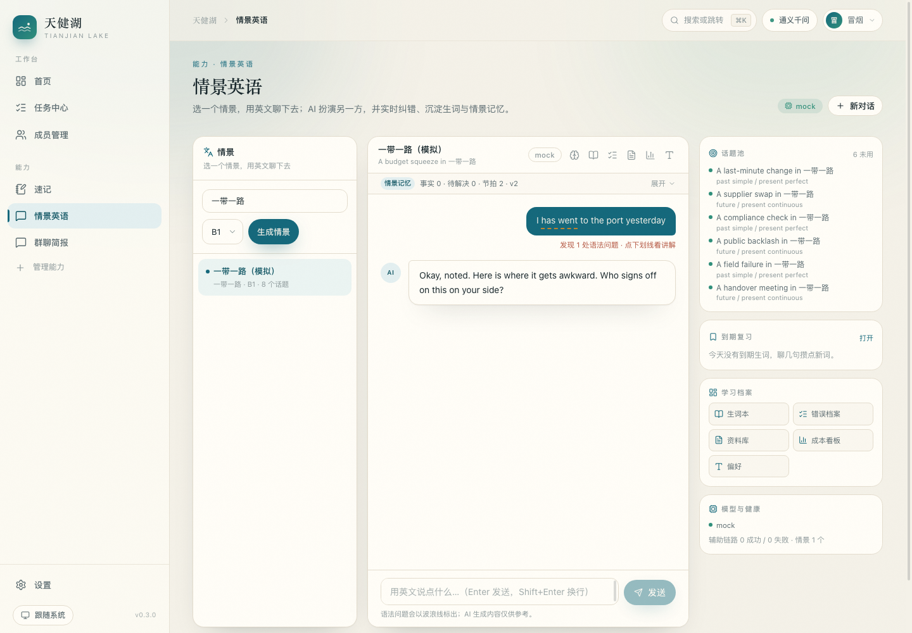

# 情景英语（english 能力）

> 从独立子项目 **etutor-cn**（Node/TS + Vue + PostgreSQL）全量移植并入主站的「输出侧训练」能力。
> 一个目录 + 一份 manifest 接入，**内核没有为它改任何东西**（唯一的内核改动是给 `LLMClient.chat`
> 加了一个可选的 `response_format` 参数，用于结构化 JSON 输出）。
>
> **本文档**：情景英语的能力范围、Agent 编排、API 与移植差异 ｜ **路径**：`docs/ENGLISH.md`
> ｜ **状态**：✅ 与 v0.3.0 代码一致 ｜ **验收**：见 [`ENGLISH-ACCEPTANCE.md`](ENGLISH-ACCEPTANCE.md)



## 能做什么

| 能力 | 说明 |
|---|---|
| 🎬 情景生成 | 输入一个领域（如「一带一路」「求职面试」）与目标水平，生成情景卡 + 6–10 个话题；每个话题带 beats、目标时态、目标词汇、难度 |
| 💬 角色扮演 | AI 以角色身份用英文推进对话，SSE 流式；同一情景多轮连续，会话落库，话题自动轮转 |
| ✏️ 每轮纠错 | 19 类闭合错误码，标出语法错误、改法与中文解释；点下划线生成知识卡 |
| 📒 生词本 | 从回复里抽候选生词，一键入库并生成中文释义；按间隔重复排程，到期复习（评分 1–4） |
| 🔁 复用注入 | 下一轮对话自动带上到期目标词，要求 AI 自然使用（不硬塞） |
| 🧠 情景记忆 | 按 `(user, scenario)` 存结构化状态（事实/未决问题/已完成节拍/立场/用词），跨会话、跨刷新接得上 |
| 📊 错误档案 | 19 类错误聚合为模式，带次数、近 7 天趋势、「已改正」判定；未改好的 Top3 回流成下一轮语境 |
| 📚 资料库 | 导入 .txt/.md/.csv 或 docx/pptx/pdf/epub，对话时 BM25 检索相关段落注入，回复下方标明来源 |
| 🎛️ 偏好契约 | 指定想多用的词、纠错强度、难度偏移、回复长度；服务端做可行性校验并给 warnings |
| 📈 成本看板 | 近 24h 轮次、TTFT、延迟 P95、token 与估算成本；月度预算超 90% 自动降级到备用模型 |

## 接入方式

- 后端：`apps/server/app/capabilities/english/`（manifest + 路由 + 迁移 + 工具 + agents）
- 前端：`apps/web/src/capabilities/english/`（能力注册表自动收集，路由 `/cap/english`）
- 数据：主库 `data/app.db` 里的 `english_*` 表（迁移 `migrations/001_english.sql`）
- 权限：所有读写都带主站 `user_id`，跨用户取会话返回 403/404
- 模型：复用主站「设置 → 模型接入」的 OpenAI 兼容供应商（按用户加密存储），不再有环境变量 Key

能力设置（「管理能力 → 情景英语」里按用户保存）：

| 设置 | 默认 | 说明 |
|---|---|---|
| 每日对话轮数上限 `daily_quota` | 30 | 超出 429（成本护栏） |
| 角色扮演模型 `partner_model` | 跟随供应商 | 留空用默认 chat_model |
| 规划 / 纠错模型 `planner_model` | 跟随供应商 | 结构化任务用 |
| 预算降级模型 `fallback_model` | 空 | 月度 token 超 90% 时切换 |
| 月度 token 预算 `monthly_token_budget` | 2,000,000 | 看板与降级依据 |
| 输入/输出价格 `price_in_per_m` / `price_out_per_m` | 2.4 / 9.6 元 | 仅成本估算 |
| 自动重写 `repair_enabled` | 开 | 回复缺问句/过长/含套话时静默重写一次 |
| 离线演示 `mock_mode` | 关 | 不调真实模型，假数据跑通链路（演示 / 测试用） |

## Agent 编排

一次 `/chat` 里真正并发的部分（照搬原项目的延迟预算：只有首字阻塞）：

```
用户消息 ─┬─ 纠错 analyze（后台并行，不参与首字，最多等 3s）
          ├─ 学习契约 contract
          ├─ 到期生词 must_use_words
          ├─ 情景记忆 memory
          ├─ 弱项回流 weak_codes
          └─ 资料检索 BM25
                    ↓
        partner.build_system_prompt → 流式回复（20s 无 token 看门狗）
                    ↓
        quality.measure_reply → 不达标则静默重写（replace 事件）
                    ↓
        落库 + 摘要后台任务（不拖 done）+ annotations / meta / done
```

| 模块 | 职责 |
|---|---|
| `agents/planner.py` | 情景 + 话题生成，唯一 slug，落库 |
| `agents/partner.py` | 系统提示（角色、节拍、目标词、记忆、资料、弱项、字数） |
| `agents/analyst.py` | 纠错：JSON 校验 + span 回验 + 规则兜底（mock 时零网络） |
| `agents/quality.py` | 回复质量评分（长度 / 问句 / 套话 / 等级词），驱动重写 |
| `agents/errors.py` | 错误档案聚合、趋势、「已改正」判定、弱项回流 |
| `agents/vocab.py` / `schedule.py` | 候选词、必用词、FSRS-lite 间隔重复 |
| `agents/memory.py` | 结构化记忆 merge（数组并集、上限、revision） |
| `agents/summary.py` | 滚动摘要（超阈值才压，骨架文本兜底） |
| `agents/rag.py` | 段落切块 + BM25 + 来源渲染 |
| `agents/extract.py` | 资料解析，复用主站 `library/parsers.py`（docx/pptx/pdf/epub/md/txt/html） |
| `agents/budget.py` / `metrics.py` | token/成本估算、预算降级、辅助链路健康自检 |
| `agents/gloss.py` / `knowledge.py` | 释义、知识卡（落库复用） |
| `agents/taxonomy.py` / `contract.py` | 19 类闭合错误码、偏好契约校验与钳制 |

## API（前缀 `/api/c/english`，全部要求登录）

| 方法 | 路径 | 说明 |
|---|---|---|
| GET | `/health` | 情景数、当前模型、辅助链路健康（degraded） |
| GET/POST | `/scenarios` | 情景列表 / 生成新情景 |
| GET | `/scenarios/{id}` | 情景 + 话题池 |
| GET | `/scenarios/{id}/conversations` | 情景下历史会话（续聊） |
| GET | `/conversations/{id}` | 会话 + 消息（**user 消息带 errors**，刷新后下划线不丢） |
| POST | `/chat` | **SSE**：`delta` / `replace` / `annotations` / `meta` / `done` / `error` |
| GET | `/knowledge/{code}` | 错误码知识卡 |
| GET | `/errors` | 错误档案（聚合 / 趋势 / 已改正） |
| GET | `/memory/{scenario_id}` | 情景记忆 |
| POST/GET | `/vocab`；POST `/vocab/review` | 生词入库 / 列表 / 复习评分 |
| POST/GET/DELETE | `/documents`、POST `/documents/upload` | 资料文本导入 / 文件上传 / 列表 / 删除 |
| GET/PUT | `/contract` | 偏好契约 |
| GET | `/stats` | 成本与质量看板 |

Agent 工具（自动进 `/api/tools`）：`english_save_vocab`、`english_learning_progress`、`english_start_scenario`。

## 与独立版的差异（移植时做的删减/增强）

- **删**：匿名用户与设备迁移码（主站有账号）、支付/会员/订单/沙箱渠道/权益表（后续按主站账号体系再加）、PGlite/PostgreSQL（主站是 SQLite）。
- **改**：`users` 引用主站 `user_id`；`jsonb`/数组 → TEXT JSON；`timestamptz` → UTC ISO 字符串；环境变量 Key → 按用户供应商；上传改为 multipart 并复用主站四种教材格式解析。
- **增**：会话消息带历史纠错（刷新不丢）、能力设置面板、3 个 Agent 工具、离线演示模式、辅助链路健康自检进入 `/health`。

## 验证

```bash
cd apps/server && .venv/bin/python -m pytest -q     # 全量后端测试（含 english 核心/状态/接口/E2E）
cd apps/web && pnpm build                            # 前端类型检查 + 构建
```

离线演示：在「管理能力 → 情景英语」打开「离线演示模式」，或直接跑测试——不会产生任何真实模型调用。
真实链路验收按 `docs/ENGLISH-ACCEPTANCE.md` 的 5 分钟清单走。
